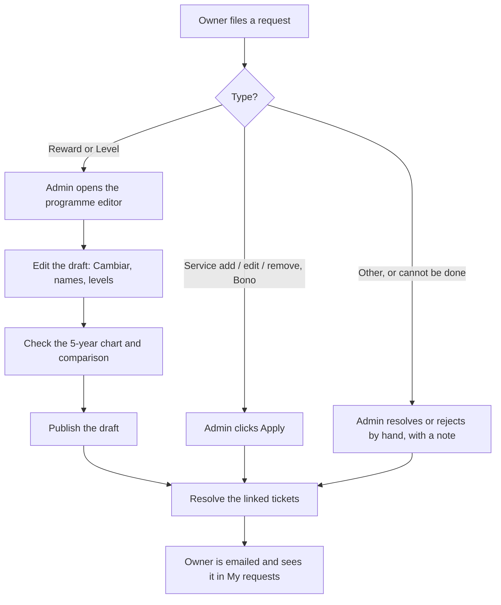

# Change requests: how to use them, step by step

Two roles use this. The **clinic owner** asks for changes. The **Voone admin** makes them. Rules, limits and every
error are in [`change-requests-edge-cases.md`](./change-requests-edge-cases.md).

## The big picture

The one rule to remember: **a Reward or Level ticket is not done until the programme is published.** Closing the
ticket alone changes nothing the clinic can see.

## A. Owner: asking for a change

Where: **My center**, then **Treatments / Rewards / Levels / Wallet Card**, then the pencil or **Request a change**.

### A1. Ask to change a reward

1. Open **My center → Rewards**.
2. Click the pencil on the reward (or **Request a change**).
3. In **Replace with**, pick an item from the catalogue (type to search), or type free text.
   - A catalogue item is priced. Free text is worth €0 and is marked "Sin valorar" for Voone to value.
4. Read the flag that appears under the picker:
   - **Good option / Costs more / Similar** with a five-year sentence.
   - Two rows of marks, **against your current plan** and **against Voone**. ▲ better, ＝ same, ▼ worse. Hover a mark
     for the amount (rounded to €100) and a rough percent.
   - **No se puede comparar**: that pick cannot be used (it would repeat a gift in a row, or it cannot be a reward).
     Pick another item.
   - **Nothing**: no estimate is possible right now. You can still send the request.
5. Write the **reason** (required) and click **Submit request**.
6. The request appears in **My requests**. Nothing changes in Rewards until Voone has published the change.

### A2. Ask to change a service price or a level

1. **Treatments**: use the icon on the service and enter the new price (or name, category). A price change on a
   service that is a reward also shows the flag. A service that is not a reward shows no flag.
2. **Levels (Niveles)**: use the icon on the tier and describe the change in free text. There is no flag.
3. Write the reason and submit.

### A3. Follow it

- **My requests** lists every request. Open one to see the status and the conversation.
- Voone's replies and decisions arrive by email and in the thread.
- You can reply on a closed request or **Reopen** it for **14 days** after it closed.
- You can have at most **20** open requests.

## B. Admin: handling a ticket

Where: **Customer care**, then the ticket.

### B1. Triage

1. Read **The request** and the **Owner's reason**.
2. Read **What it would do to the plan** (REWARD and SERVICE_EDIT tickets). It shows the exact comparison, or the reason
   no comparison exists:
   - A table of five years: current plan, proposed, Voone's recommendation, with euros and percents.
   - "That change would repeat a gift in two consecutive milestones" means it cannot be applied as asked.
   - "That service is not a live reward" means the price change does not touch any reward.
3. Decide: do it, change it, or reject it. Use **Start work** to mark it In progress, or reply in the thread.
   A reply never changes the status.

### B2. A Reward or Level ticket

1. In the **Programme** card, click **Open the programme editor**.
   This reuses the clinic's draft or creates one from the active programme, links it to the ticket, and moves
   the ticket to In progress. It does **not** apply the owner's choice: you make the edit.
2. In the editor, find the reward row and click **Cambiar** (use **Cambiar**, not the pencil).
   - Pick an engine alternative with **Usar este**, or search any catalogue item.
   - The row's grey "Reward value" shows the new item's retail price. The figure on the right (what the customer
     spent) stays the same.
   - If it is refused, the message under the list says why (repeat in a row, no price, no category, medical).
3. To rename only, use the pencil. This changes the displayed title and nothing else.
4. For a Level request, edit the tier's benefit lines in the same editor.
5. Look at **What the program costs and what it generates**. It refreshes after each swap. Compare with the
   five-year comparison against Voone's recommendation.
6. If the page says there are review notes to resolve, fix what it names. A cost note is information only.
7. Click **Publish**. Members are re-placed on the new ladder and wallet cards refresh.
8. The app offers to **resolve the linked tickets**. Write a note (the owner receives it) and confirm. Every ticket
   linked to that programme is resolved and its owner emailed.
9. Check the clinic's **Rewards** tab: the reward and the milestone now show the change.

### B3. A service or bono ticket

1. Read the **warnings** on the ticket: which live rewards use the service, and whether the catalogue differs from
   the active programme.
2. If it is a new service at a clinic that uses the catalogue, pick the **category** when asked.
3. Click **Apply**. The catalogue change and the resolution happen together. The owner is emailed.
4. The programme is **not** changed. If the change should reach the rewards or the chart, generate a new draft from the
   catalogue, review it and publish it (section B2, steps 5 to 9).
5. If Apply is refused (the service no longer exists, invalid values), the ticket stays open: resolve it by hand or
   reject it with a note.

### B4. Other tickets, or ones that cannot be done

- **Resolve** with a note saying what was done, or **Reject** with a note saying why.
- On a Reward or Level ticket the Resolve box warns that resolving does not change the programme.

### B5. Reopen

- The owner can reopen within 14 days. An admin can move a closed ticket back to Open at any time.
- A reopened ticket keeps its earlier resolution note in the thread.
- A ticket that was applied cannot be applied again; resolve or reject it by hand.

## C. Quick answers

| Question                                                                | Answer                                                                                      |
| ----------------------------------------------------------------------- | ------------------------------------------------------------------------------------------- |
| I resolved the ticket but Rewards did not change.                       | Resolving does not edit the programme. Open the programme editor, swap, publish.            |
| "Cambiar" says there is no reward at that milestone.                    | You are on a perk or level row. Swap on a reward row.                                       |
| I clicked the pencil and the value did not change.                      | The pencil renames only. Use **Cambiar**.                                                   |
| The chart did not change after a swap.                                  | It refreshes after each swap now. Reload if the page predates the fix.                      |
| An item the owner picked says "not in the catalogue".                   | It is not in the clinic's catalogue. Add it first.                                          |
| I edited a treatment price and the programme still shows the old value. | The programme keeps its own copy of the catalogue. Generate a new draft and publish it.     |
| The owner sees no comparison.                                           | No estimate was possible (see the edge-cases document, section 4.1). They can still submit. |
| Which number is the reward's price?                                     | "Reward value" under the title. The number on the right is the customer's spend.            |
